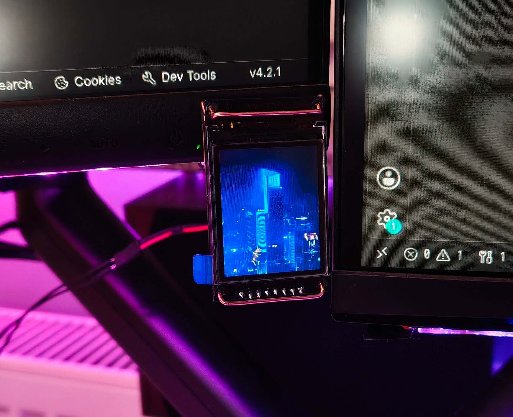
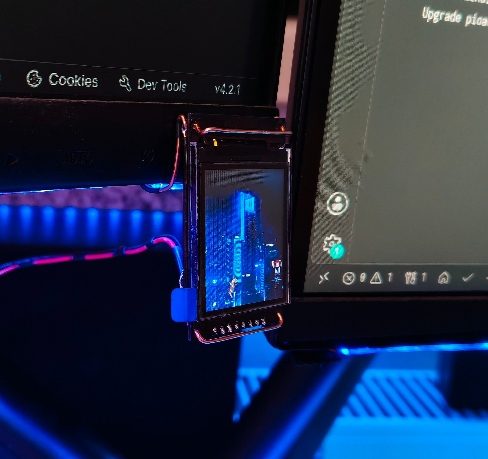
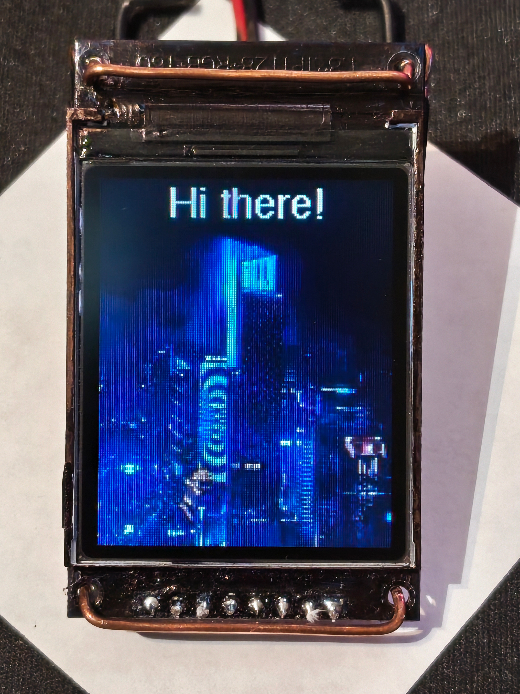
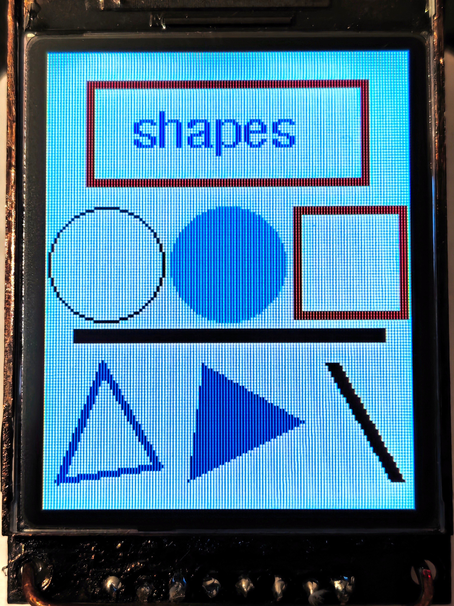
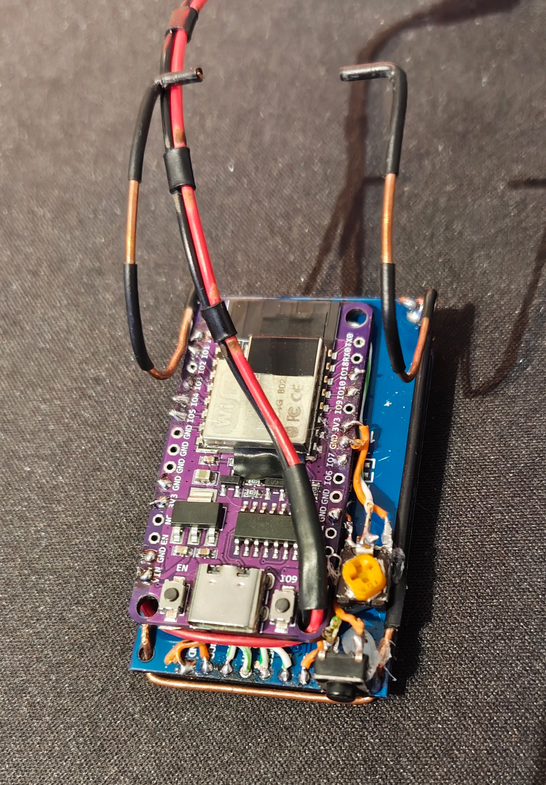

# ESP32-C2 Wi-Fi TFT Display

### A small ESP32-C2 project that exposes an HTTP API for drawing on an ST7735-compatible TFT display over Wi-Fi.

<div align="center">
  
  
  <br><br>
  
  
  
</div>


Controll your TFT display over HTTP requests from any place of your house!

## Table of contents

- [Features](#features)
- [How it works](#how-it-works)
- [Build](#build)
- [Configuration](#configuration)
- [API](#API)
  - [Endpoints](#endpoints)
  - [Images](#images)


## Features

- Controlled by HTTP using Wi-Fi
- Supports images (size and position) - 
- Optional image dimensions and display position.
- Drawing endpoints for lines, rectangles, circles, triangles, individual pixels, and text.
- Screen-clearing endpoint.
- Serial output with upload diagnostics and validation results.

## How it works

1. The ESP8684 connects to WiFi
2. The HTTP server is started on port `80` by default
3. The potentiometer controlls the brigthess and button allows you to turn it ON / OFF(hold for 1 sec) / SLEEP
4. A client sends an HTTP request to one of the registered endpoints.
5. Each query is a draw on what already exists like layers
6. When the image upload finishes, the firmware checks the received pixel count, byte alignment, and total file size.

## Build

  ### Hardware Components
  - ESP8684 – main microcontroller.
  - TFT LCD ST7735S / ST7789 – display module.
  - Potentiometer – display brightness control.
  - Push button / switch – ON / OFF / SLEEP control.

  ### ESP pin default configuration
  
  | Variable name in config | Default GPIO | Description |
  | --- | --- | --- |
  | `SWITCH` | GPIO2 | Switch - ON / OFF |
  | `POT_PIN` | GPIO0 | Potentiometer - Brightness |
  | `TFT_SCK` | GPIO4 | (SCK) |
  | `TFT_MOSI` | GPIO5 | (MOSI) |
  | `TFT_CS` | GPIO7 | (CS) |
  | `TFT_DC` | GPIO3 | (DC) |
  | `TFT_RST` | GPIO1 | (TX) |
  | `TFT_BL` | GPIO10 | (BL) |
  

## Configuration

check out the `config/config.h` file

```h
// WiFi setup
#define WIFI_SSID "WiFi "
#define WIFI_PASSWORD "Password"

// WiFi Configuration
#define WIFI_LOCAL_IP IPAddress(192, 168, 0, 35) // Ip will be used to send HTTP requests. Remember to configure DHCP on your router, otherwise this ip might be assigned to other devices!
#define WIFI_GATEWAY IPAddress(192, 168, 0, 1)
#define WIFI_SUBNET IPAddress(255, 255, 255, 0)
#define WIFI_PRIMARY_DNS IPAddress(1, 1, 1, 1)
#define WIFI_SECONDARY_DNS IPAddress(1, 0, 0, 1)
#define HTTP_SERVER_PORT 80

// Display size + driver settings
#define DISPLAY_WIDTH  128
#define DISPLAY_HEIGHT  160
#define DISPLAY_ROTATION 2 // 2 -> portrait upside down
#define TFT_INIT_TYPE INITR_BLACKTAB //If doesn't work try INITR_GREENTAB / INITR_REDTAB or check out Adafruit_GFX docs for Adafruit_ST7735


// Switch - ON / OFF / SLEEP
#define SWITCH 2

// TFT display pins
#define TFT_SCK  4   // GPIO4 (SCK)
#define TFT_MOSI 5   // GPIO5 (MOSI)
#define TFT_CS   7   // GPIO7 (CS)
#define TFT_DC   3   // GPIO3 (DC)
#define TFT_RST  1   // GPIO1 (TX)
#define TFT_BL   10  // GPIO10 (BL)

// Potentiometer pin - brightness
#define POT_PIN  0  //GPIO0
```

## API

### Just try out your self with Postman or Bruno:

### [Download postman](./assets/WIFI%20Display%20Postman.json)

### [Download bruno](./assets/WIFI%20Display%20Bruno.zip)

Remember to change the `url` var to ip you have assigned to the ESP8684 (like `192.168.0.35`)
Meaning of the keys:

| key | meaning|
| --- | --- |
| w |  width |
| h |  height |
| x |  position x |
| y |  position y |
| color |  color in hex (FFFFFF - white, without #) |
| thickness |  thickness |
| fill |  fill shape with color, 0(no) or 1(yes) |
| data |  data you wanna send, like text |
| size |  font size |
| wrap |  wrap line 1(yes) or 0(no) |
| r |  radius of the circle |


### endpoints

| Method | Path | Description |
| --- | --- | --- |
| `POST` | `/upload` | Upload and draw a raw RGB565 image |
| `POST` | `/clear` | Clear the display or fill with color |
| `POST` | `/text` | Draw text |
| `POST` | `/line` | Draw a line |
| `POST` | `/rect` | Draw a rectangle |
| `POST` | `/circle` | Draw a circle |
| `POST` | `/triangle` | Draw a triangle |
| `POST` | `/pixel` | Draw a single pixel |

### images

  To upload image you need to convert it to pure raw. You can just use python script below:
  ```python
  from PIL import Image
  import struct

  input_img = "image.jpg"
  output_img = "image_output.raw"
  width = 128
  height = 160

  # Load image and resize to screen size:
  im = Image.open(input_img).convert("RGB")
  im = im.resize((width, height))  # width , height

  #Open binary file for converted image
  with open(output_img, "wb") as f:
      for y in range(im.height):
          for x in range(im.width):
              r, g, b = im.getpixel((x, y))
              # Color conversion RGB888 → RGB565
              rgb565 = ((r & 0xF8) << 8) | ((g & 0xFC) << 3) | (b >> 3)
              # save 2 bytes: MSB, LSB
              f.write(struct.pack(">H", rgb565))
  ```
  Simply run it by:
  `python ./converter.py`

  Use output `image_output.raw` file in the request - `file` parameter.
  ### Remember width and height from the script must match `w` and `h` values from the request parameters.
  Example
  	
| key | value|    
| ---|---|
| w |  128 |
| h |  160 |
| x |  0 |
| y |  0 |
| file |  image_output.raw |